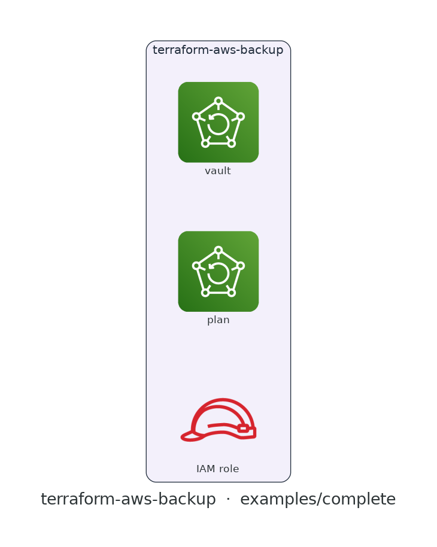

# terraform-aws-backup

[](https://github.com/devotica-labs/terraform-aws-backup/actions/workflows/ci.yml)
[](https://github.com/devotica-labs/terraform-aws-backup/actions/workflows/release.yml)
[](LICENSE)

> Part of the **Devotica** Terraform catalog. Follows the cloudposse module standard (README.yaml-driven docs, the `enabled`/`namespace`/`environment`/`stage`/`name`/`attributes`/`tags`/`label_order` label surface, `examples/complete`, Makefile targets) implemented **natively** — no external naming or build-harness dependencies.

## Introduction

Terraform module for **AWS Backup** — a KMS-encrypted backup vault, a plan with one or more scheduled rules, a resource/tag selection, and a dedicated service role. It ships fintech-safe defaults so a workload is centrally backed up, encrypted, and retained out of the box.

Defaults are opinionated: an **encrypted vault**, a **daily rule with 35-day retention**, an auto-created **service role** (trusting `backup.amazonaws.com`, with the AWS-managed backup + restore policies), optional **cold storage**, and an optional **compliance vault lock** (WORM) for regulated data.

## Architecture

<!-- BEGIN_ARCH -->



<sub>Generated by `.github/workflows/architecture-diagram.yml` on every push to main. Do not edit the image by hand — change the Terraform code in `examples/complete/` and the bot will regenerate it.</sub>

<!-- END_ARCH -->

## Usage

```hcl
module "backup" {
  source  = "devotica-labs/backup/aws"
  version = "~> 0.1"

  namespace = "dvtca"
  stage     = "prod"
  name      = "db"          # vault/plan → dvtca-prod-db

  # Tag-based selection: back up every resource tagged backup=daily.
  selection_tags = {
    backup = "daily"
  }

  # Fintech defaults cover encryption, the daily 35-day rule, and the role.
  tags = local.tags
}
```

Tiered rules with explicit resource ARNs, a customer-managed key, and a compliance vault lock:

```hcl
module "backup" {
  source  = "devotica-labs/backup/aws"
  version = "~> 0.1"

  namespace   = "dvtca"
  stage       = "prod"
  name        = "payments"
  kms_key_arn = module.kms.key_arn

  rules = [
    { name = "daily", schedule = "cron(0 5 * * ? *)", delete_after = 35 },
    { name = "weekly", schedule = "cron(0 5 ? * 1 *)", cold_storage_after = 30, delete_after = 365 },
  ]

  selection_resource_arns = [module.rds.arn]

  vault_lock = {
    min_retention_days  = 35
    max_retention_days  = 3650
    changeable_for_days = 3
  }
}
```

See [`examples/basic`](examples/basic) and [`examples/complete`](examples/complete).

## Defaults that matter

| Setting | Default | Why |
|---------|---------|-----|
| vault encryption | KMS | The vault is always KMS-encrypted; `kms_key_arn` null uses the AWS-managed `aws/backup` key, or supply a CMK. |
| `rules` | one daily rule, `delete_after = 35` | Recovery points are taken daily and retained 35 days unless overridden. |
| `backup_role_arn` | `null` → role created | A dedicated role trusting `backup.amazonaws.com` with the AWS-managed backup + restore policies. |
| cold storage | off | `cold_storage_after` is per-rule and null by default (warm storage only). |
| `vault_lock` | `null` | Opt in to WORM/compliance mode with a retention window when regulated. |

## How this fits the Devotica catalog

Point `selection_resource_arns` (or `selection_tags`) at resources created by the other Devotica modules — `terraform-aws-rds`, EBS volumes, DynamoDB tables, EFS file systems — to bring them under a single central backup plan. Supply `kms_key_arn` from `terraform-aws-kms` for a customer-managed vault key.

## Makefile Targets

```
make fmt       # terraform fmt -recursive
make validate  # terraform init -backend=false && terraform validate
make test      # terraform test (unit + contract; integration needs AWS creds)
make readme    # regenerate the terraform-docs block below
```

<!-- BEGIN_TF_DOCS -->


## Usage

### Basic

```hcl
# ---------------------------------------------------------------------------
# Provider block — CI-friendly skip flags + non-AWS-shaped placeholder creds.
# ---------------------------------------------------------------------------
provider "aws" {
  region                      = "ap-south-1"
  access_key                  = "not-a-real-aws-key"
  secret_key                  = "not-a-real-aws-secret"
  skip_credentials_validation = true
  skip_metadata_api_check     = true
  skip_requesting_account_id  = true
}

# Uses local path during development.
# Change to Registry source after first release:
#   source  = "devotica-labs/backup/aws"
#   version = "~> 0.1"

module "backup" {
  source = "../.."

  # Vault / plan / selection / role name composes to: dvtca-sandbox-db
  namespace = "dvtca"
  stage     = "sandbox"
  name      = "db"

  # Tag-based selection: back up every resource tagged backup=daily.
  selection_tags = {
    backup = "daily"
  }

  # Fintech defaults cover the rest: KMS-encrypted vault (aws/backup key), a
  # single daily rule with 35-day retention, and a dedicated service role.

  tags = {
    Environment = "sandbox"
    Project     = "terraform-aws-backup"
    Owner       = "platform@devotica.com"
    CostCenter  = "PLATFORM-OSS"
    ManagedBy   = "Terraform"
    Repo        = "https://github.com/devotica-labs/terraform-aws-backup"
  }
}
```

### Complete

```hcl
# ---------------------------------------------------------------------------
# Provider block — CI-friendly skip flags + non-AWS-shaped placeholder creds.
# ---------------------------------------------------------------------------
provider "aws" {
  region                      = "ap-south-1"
  access_key                  = "not-a-real-aws-key"
  secret_key                  = "not-a-real-aws-secret"
  skip_credentials_validation = true
  skip_metadata_api_check     = true
  skip_requesting_account_id  = true
}

# A compliance-grade backup for the payments platform: multiple tiered rules
# (daily / weekly / monthly with cold storage), explicit resource ARNs, a
# customer-managed KMS key, and a WORM vault lock so recovery points are
# immutable for the retention window.
module "backup" {
  source = "../.."

  namespace = "dvtca"
  stage     = "prod"
  name      = "payments"

  # Customer-managed key instead of the AWS-managed aws/backup key.
  kms_key_arn = "arn:aws:kms:ap-south-1:111122223333:key/00000000-0000-0000-0000-000000000000"

  # Tiered retention. Weekly/monthly tier surplus recovery points into cold
  # storage before deletion (cold_storage_after must be >= 90 days before
  # delete_after per AWS Backup).
  rules = [
    {
      name              = "daily"
      schedule          = "cron(0 5 * * ? *)"
      start_window      = 60
      completion_window = 360
      delete_after      = 35
    },
    {
      name               = "weekly"
      schedule           = "cron(0 5 ? * 1 *)"
      cold_storage_after = 30
      delete_after       = 365
    },
    {
      name               = "monthly"
      schedule           = "cron(0 5 1 * ? *)"
      cold_storage_after = 90
      delete_after       = 2555
    },
  ]

  # Explicit resource ARNs instead of tag-based selection.
  selection_resource_arns = [
    "arn:aws:rds:ap-south-1:111122223333:db:payments-primary",
    "arn:aws:dynamodb:ap-south-1:111122223333:table/payments-ledger",
  ]

  # Compliance vault lock (WORM): recovery points can't be deleted before 35
  # days; the lock itself becomes immutable after 3 days.
  vault_lock = {
    min_retention_days  = 35
    max_retention_days  = 3650
    changeable_for_days = 3
  }

  tags = {
    Environment = "prod"
    Project     = "terraform-aws-backup"
    Owner       = "platform@devotica.com"
    CostCenter  = "PLATFORM-OSS"
    ManagedBy   = "Terraform"
    Repo        = "https://github.com/devotica-labs/terraform-aws-backup"
  }
}
```

## Requirements

| Name | Version |
|------|---------|
| <a name="requirement_terraform"></a> [terraform](#requirement\_terraform) | >= 1.7.0, < 2.0.0 |
| <a name="requirement_aws"></a> [aws](#requirement\_aws) | ~> 6.44 |
## Providers

| Name | Version |
|------|---------|
| <a name="provider_aws"></a> [aws](#provider\_aws) | ~> 6.44 |
## Resources

| Name | Type |
|------|------|
| [aws_backup_plan.this](https://registry.terraform.io/providers/hashicorp/aws/latest/docs/resources/backup_plan) | resource |
| [aws_backup_selection.this](https://registry.terraform.io/providers/hashicorp/aws/latest/docs/resources/backup_selection) | resource |
| [aws_backup_vault.this](https://registry.terraform.io/providers/hashicorp/aws/latest/docs/resources/backup_vault) | resource |
| [aws_backup_vault_lock_configuration.this](https://registry.terraform.io/providers/hashicorp/aws/latest/docs/resources/backup_vault_lock_configuration) | resource |
| [aws_iam_role.this](https://registry.terraform.io/providers/hashicorp/aws/latest/docs/resources/iam_role) | resource |
| [aws_iam_role_policy_attachment.this](https://registry.terraform.io/providers/hashicorp/aws/latest/docs/resources/iam_role_policy_attachment) | resource |
## Inputs

| Name | Description | Type | Default | Required |
|------|-------------|------|---------|:--------:|
| <a name="input_attributes"></a> [attributes](#input\_attributes) | Additional attributes appended to the id (e.g. ["workers"]). | `list(string)` | `[]` | no |
| <a name="input_backup_role_arn"></a> [backup\_role\_arn](#input\_backup\_role\_arn) | Existing IAM role ARN for AWS Backup to assume. Null (default) creates a dedicated role trusting backup.amazonaws.com with the AWS-managed backup + restore policies attached. | `string` | `null` | no |
| <a name="input_delimiter"></a> [delimiter](#input\_delimiter) | Delimiter joining the id segments. | `string` | `"-"` | no |
| <a name="input_enabled"></a> [enabled](#input\_enabled) | Set to false to make this module a no-op (create nothing). | `bool` | `true` | no |
| <a name="input_environment"></a> [environment](#input\_environment) | Environment segment (e.g. a short region code). | `string` | `null` | no |
| <a name="input_id_length_limit"></a> [id\_length\_limit](#input\_id\_length\_limit) | Truncate the composed id to at most this many characters. 0 means no limit. | `number` | `0` | no |
| <a name="input_kms_key_arn"></a> [kms\_key\_arn](#input\_kms\_key\_arn) | Customer-managed KMS key ARN encrypting the backup vault. Null uses the AWS-managed aws/backup key. Recovery points are always encrypted either way. | `string` | `null` | no |
| <a name="input_label_order"></a> [label\_order](#input\_label\_order) | Order of the label segments used to build the id. Allowed keys: namespace, environment, stage, name, attributes. | `list(string)` | <pre>[<br/>  "namespace",<br/>  "environment",<br/>  "stage",<br/>  "name",<br/>  "attributes"<br/>]</pre> | no |
| <a name="input_label_value_case"></a> [label\_value\_case](#input\_label\_value\_case) | Case applied to the composed id: lower, upper, or none. | `string` | `"lower"` | no |
| <a name="input_name"></a> [name](#input\_name) | Solution / base name (e.g. "app"). | `string` | `null` | no |
| <a name="input_namespace"></a> [namespace](#input\_namespace) | Namespace / org prefix (e.g. "dvtca"). | `string` | `null` | no |
| <a name="input_regex_replace_chars"></a> [regex\_replace\_chars](#input\_regex\_replace\_chars) | Regex (in /.../ form) of characters stripped from each id segment. | `string` | `"/[^-a-zA-Z0-9]/"` | no |
| <a name="input_rules"></a> [rules](#input\_rules) | Backup plan rules. Each rule is a scheduled job: name, a cron/rate schedule, optional start/completion windows (minutes), optional cold\_storage\_after (days, null = warm only), and delete\_after (days retention). Default is a single daily rule with 35-day retention. | <pre>list(object({<br/>    name               = string<br/>    schedule           = string<br/>    start_window       = optional(number, 60)<br/>    completion_window  = optional(number, 360)<br/>    cold_storage_after = optional(number)<br/>    delete_after       = optional(number, 35)<br/>  }))</pre> | <pre>[<br/>  {<br/>    "name": "daily",<br/>    "schedule": "cron(0 5 * * ? *)"<br/>  }<br/>]</pre> | no |
| <a name="input_selection_resource_arns"></a> [selection\_resource\_arns](#input\_selection\_resource\_arns) | Explicit resource ARNs to include in the backup plan (e.g. RDS, EBS, DynamoDB, EFS). Empty relies on selection\_tags for tag-based selection. | `list(string)` | `[]` | no |
| <a name="input_selection_tags"></a> [selection\_tags](#input\_selection\_tags) | Tag-based selection: every resource carrying each key=value tag (STRINGEQUALS) is backed up. Empty relies on selection\_resource\_arns. | `map(string)` | `{}` | no |
| <a name="input_stage"></a> [stage](#input\_stage) | Stage / account segment (e.g. "prod"). | `string` | `null` | no |
| <a name="input_tags"></a> [tags](#input\_tags) | Additional tags merged onto every taggable resource. | `map(string)` | `{}` | no |
| <a name="input_vault_lock"></a> [vault\_lock](#input\_vault\_lock) | Enable AWS Backup Vault Lock (compliance mode / WORM) with the given retention window. Null (default) leaves the vault unlocked. Once changeable\_for\_days elapses the lock is immutable and recovery points cannot be deleted before min\_retention\_days. | <pre>object({<br/>    min_retention_days  = number<br/>    max_retention_days  = number<br/>    changeable_for_days = number<br/>  })</pre> | `null` | no |
## Outputs

| Name | Description |
|------|-------------|
| <a name="output_plan_arn"></a> [plan\_arn](#output\_plan\_arn) | ARN of the backup plan. |
| <a name="output_plan_id"></a> [plan\_id](#output\_plan\_id) | ID of the backup plan. |
| <a name="output_role_arn"></a> [role\_arn](#output\_role\_arn) | ARN of the IAM role AWS Backup assumes (created here or the supplied backup\_role\_arn). |
| <a name="output_vault_arn"></a> [vault\_arn](#output\_vault\_arn) | ARN of the backup vault. |
| <a name="output_vault_name"></a> [vault\_name](#output\_vault\_name) | Name of the backup vault. |
<!-- END_TF_DOCS -->

## License

[Apache 2.0](LICENSE) © Devotica
